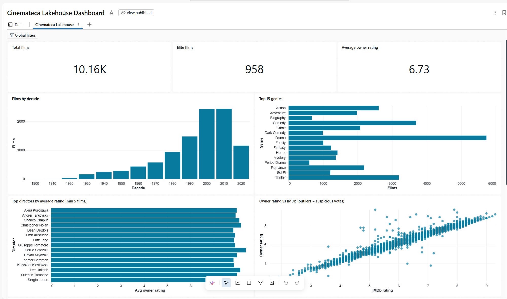
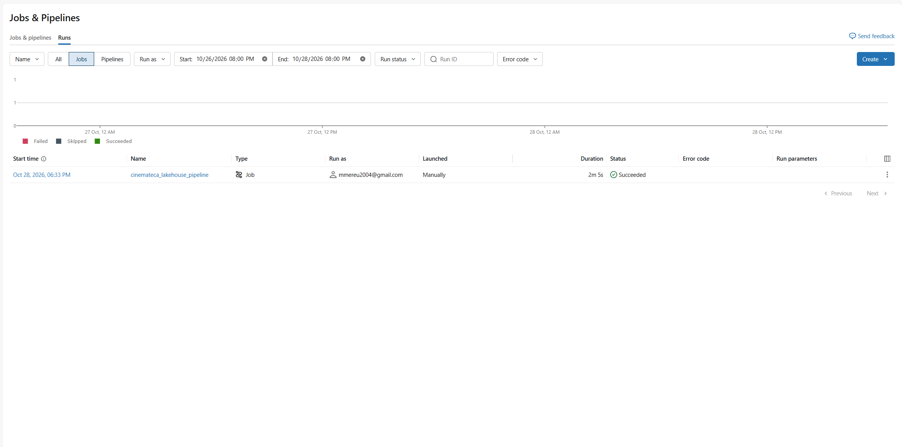

# Cinemateca Lakehouse

A **medallion-architecture lakehouse** on **Databricks Free Edition**, built on top of my
[Cinemateca](https://github.com/mmereu97/cinemateca-data-pipeline) film-catalogue project
(10,000+ films, ~100 attributes each, collected by a Python scraping pipeline).

The original project computes scores in pandas + SQLite. This project reimplements the
pipeline as a governed, orchestrated lakehouse: **Unity Catalog + Delta Lake + PySpark +
Databricks Jobs + an AI/BI dashboard** — and validates the new implementation against the
old one.

```
Excel export (local)
      │  local_prep/prepare_data.py
      │  drops private columns, extracts IMDb hyperlinks, writes Parquet
      ▼
Unity Catalog Volume  /Volumes/cinemateca/bronze/raw/
      │  01_bronze_ingest      raw Delta table + audit columns
      ▼
cinemateca.bronze.movies_raw
      │  02_silver_clean       types, validation (quarantine), dedup, explode
      ▼
cinemateca.silver.movies / movie_genres / movie_actors / movie_directors / movies_rejected
      │  03_gold_scoring       final score, elite ranking, analytics
      ▼
cinemateca.gold.movie_scores / movies_by_decade / movies_by_genre / top_directors / rating_divergence
      │
      ▼
AI/BI dashboard  (dashboard/cinemateca_dashboard.lvdash.json)
```

Orchestrated by a **Databricks Job** (`bronze_ingest → silver_clean → gold_scoring`)
scheduled monthly. `04_incremental_merge` additionally demonstrates **MERGE INTO**,
**time travel** and **RESTORE** on Delta tables.

## Highlights

- **Medallion architecture** with one schema per layer (`bronze` / `silver` / `gold`)
  in Unity Catalog; raw files live in a UC Volume, so every layer can be rebuilt.
- **Data quality with a quarantine pattern**: 6 validation rules; failing rows land in
  `silver.movies_rejected` with explicit reasons instead of disappearing.
- **Regression-tested transformation**: the Gold notebook reimplements the legacy
  scoring ([rules](https://github.com/mmereu97/cinemateca-data-pipeline/blob/main/docs/SCORING.md))
  in PySpark and **asserts** that the elite top 3 matches the legacy output
  (The Shawshank Redemption, The Godfather, The Dark Knight) — the job fails otherwise.
- **Incremental pattern**: atomic upserts via `MERGE INTO`, point-in-time queries via
  `VERSION AS OF`, rollback via `RESTORE TABLE`.
- **Dashboard as code**: the AI/BI dashboard is a versioned `.lvdash.json` file.
- A fun side-effect: the `gold.rating_divergence` table (raw unweighted rating vs IMDb's
  weighted rating) surfaces films with **manipulated votes** — large positive gaps match
  titles whose rating distribution is dominated by bought 10s.

## Repository layout

```
local_prep/      Excel → Parquet preparation (runs locally; Spark can't read .xlsx,
                 and the IMDb link is a cell hyperlink only openpyxl can see)
notebooks/       Databricks notebooks in source format (directly importable)
dashboard/       AI/BI dashboard definition (.lvdash.json, importable)
sample/          50-film sample spreadsheet (the full collection is private)
tests/           pytest tests for the preparation helpers
docs/img/        screenshots
```

## Run it yourself (Free Edition)

1. Create a free workspace at [databricks.com/learn/free-edition](https://www.databricks.com/learn/free-edition).
2. Prepare the data locally:
   ```bash
   pip install pandas openpyxl pyarrow
   python local_prep/prepare_data.py sample/sample_movies.xlsx out/
   ```
3. In the **SQL Editor**, create the structure:
   ```sql
   CREATE CATALOG IF NOT EXISTS cinemateca;
   CREATE SCHEMA IF NOT EXISTS cinemateca.bronze;
   CREATE SCHEMA IF NOT EXISTS cinemateca.silver;
   CREATE SCHEMA IF NOT EXISTS cinemateca.gold;
   CREATE VOLUME IF NOT EXISTS cinemateca.bronze.raw;
   ```
4. Upload `out/cinemateca_movies.parquet` to the `raw` volume (Catalog → upload).
5. Import the four notebooks (`Workspace → Import`) and run 01 → 02 → 03.
   *Note: the top-3 assertion in notebook 03 expects the full collection; on the
   50-film sample, comment it out.*
6. Create a Job with three notebook tasks chained by dependencies; schedule as desired.
7. Import `dashboard/cinemateca_dashboard.lvdash.json` (`Workspace → Import`) and publish.

## Screenshots

| | |
|---|---|
|  |  |

## Data note

Film metadata belongs to IMDb/TMDB; only a 50-film sample ships here. The full export
is prepared locally, where private columns (file paths, sizes) are stripped before
anything leaves the machine.

## AI disclosure

Built in collaboration with **Claude (Anthropic)** as pair programmer — openly, as in
all my projects. The architecture decisions, the Databricks workflow and every line of
code were reviewed, run and validated by me.

## Next steps

- Rewrite Silver/Gold as a **Lakeflow (Delta Live Tables) pipeline** with expectations.
- Package with **Databricks Asset Bundles** for CI/CD deployment.
- Switch ingestion to a **file-arrival trigger** on the Volume.
- Project 2: an electrical-products catalogue — Scrapy → Databricks.

## License

Code under the [MIT License](LICENSE). Data and images belong to their respective owners.
